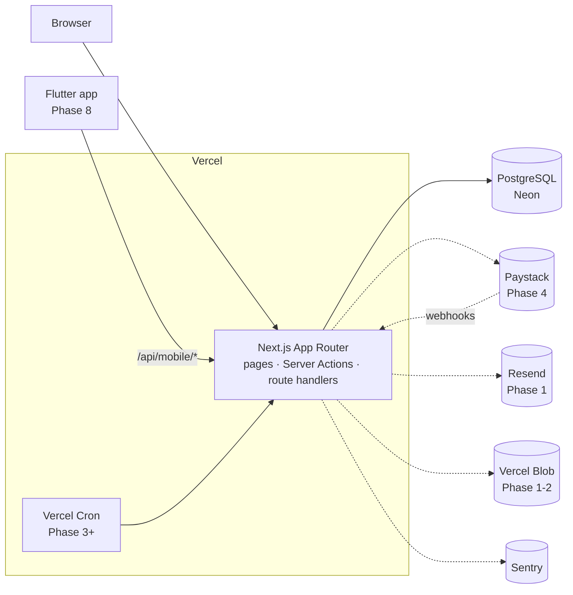

# Architecture

Business rules (commission, delivery, payout timing) are in [`CLAUDE.md`](../CLAUDE.md). This document covers how the system is built.

## Overview

One Next.js application serves the storefront, the seller dashboard, the admin area and the API. Public catalog pages are server-rendered so search engines can index them. Writes go through Server Actions (web) or route handlers (mobile app, webhooks), and every one checks the caller's role and ownership on the server.

## Core design rules

1. **Money is integer pesewas** (`Int`), percentages are basis points. Helpers in `lib/money.ts`; never use floats for money.
2. **Business numbers live in `PlatformSettings`** (single row), editable by the Super Admin, never hard-coded.
3. **Checkout is one transaction** that re-prices from the database and reserves stock with row locks (Phase 3).
4. **Multi-seller orders split into per-seller sub-orders**, each with its own status machine and history (Phase 3, 5).
5. **Seller money is a ledger** (pending → available → paid out), driven by delivery confirmation and the payout hold (Phase 4).
6. **Webhooks are verified and idempotent** (signature check, then re-verify with Paystack, then process each event once) (Phase 4).
7. **Server-side authorization everywhere.** Hiding a button is never the check.
8. **Configuration is validated** (`lib/env.ts`, Zod) and read lazily, so a missing key fails loudly on first use.

## Data access

Prisma 7 with the `@prisma/adapter-pg` (node-postgres) driver adapter. The same driver works against the local Docker database and Neon's pooled endpoint. `DATABASE_URL` is the pooled connection used at runtime; `DIRECT_URL` is the direct connection used by migrations (`prisma.config.ts`). The generated client lives in `lib/generated/prisma` (git-ignored, generated on `npm install`).

## Catalog

- **Categories** are rows, not code: an admin-edited tree (max 3 levels) with per-category attributes inherited down the tree. The whole tree is one cached query (`lib/catalog/categories.ts`, tag `categories`), and pure helpers in `lib/catalog/tree.ts` answer visibility, inheritance and move checks. Admin actions invalidate the tag, so changes are live on the next request.
- **Products** hold options as JSON and one `ProductVariant` row per combination (SKU, price, stock). The product row keeps a denormalised price range and stock total for listing and sorting without joins. A product is public only if it's active, not blocked, its store is active and its category and all ancestors are active.
- **Search** goes through `lib/search/` (`CatalogSearch` interface). The Postgres implementation uses a trigger-maintained weighted `tsvector` plus `pg_trgm` word similarity, attribute filters as indexed `EXISTS` subqueries, and keyset pagination for browse sorts. A dedicated engine can replace it behind the same interface.
- **URLs:** `/c/<slug>` (old slugs 301), `/p/<slug>` (never changes), `/s/<slug>`, `/search`. Sitemaps are an index plus 10,000-URL files built on request.

## Observability

- `lib/logger.ts`: one-line JSON logs with key-based secret redaction (tokens, passwords, Ghana Card numbers).
- Sentry: errors and traces when `NEXT_PUBLIC_SENTRY_DSN` is set. Request bodies, cookies and automatic user data are not sent (`lib/sentry-options.ts`).
- `GET /api/health` (liveness, no dependencies) and `GET /api/health/ready` (database round trip, 503 on failure).
