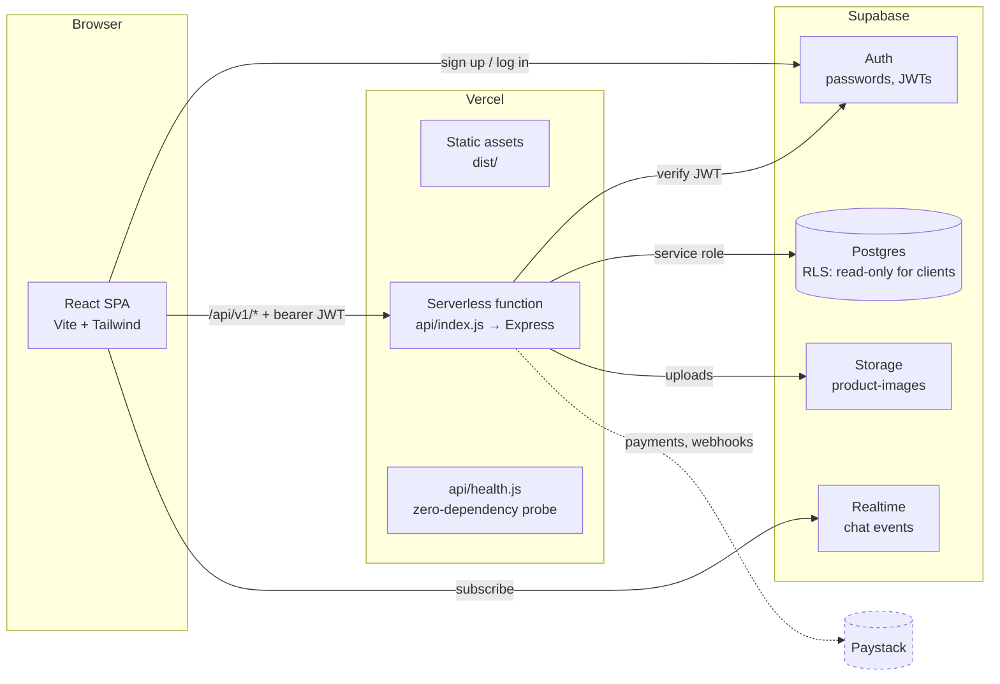

# System Architecture

BestMart is a **multi-vendor marketplace** for Ghana: buyers shop across many
independent sellers, and sellers run their own storefront from a dashboard.

This document describes the architecture **as built** and the **target**
it is evolving toward. Anything not yet implemented is marked *(planned)* and
tracked in [DEVELOPMENT_CHECKLIST.md](DEVELOPMENT_CHECKLIST.md).

## Overview



**Key rule:** the browser never writes to the database. Every write goes
through the Express API, which authenticates the caller, validates input,
and enforces ownership. Row-level security remains as a second, read-only
layer (migration `007_lock_down_client_writes.sql`), needed for Realtime.

## Technology decisions

| Concern | Choice | Why |
|---|---|---|
| Web app | React 19 + Vite + Tailwind 4 | Existing, working; Vite builds in seconds. Next.js would mainly add SEO for product pages; revisit if organic search matters. |
| API | Express 5, modular routers | Existing; Express 5 forwards async errors natively. Clean module boundaries give NestJS-style structure without a rewrite. |
| Language | JavaScript **type-checked by TypeScript in strict mode** (`checkJs`, JSDoc types) | Full strict type-checking with zero change to the Vercel build. Files can be renamed to `.ts` incrementally later. |
| Validation | Zod schemas in `shared/schemas/` | One definition used by the API (authoritative) and the web app (instant feedback). |
| Database | Supabase Postgres, SQL migrations | Managed backups/PITR, RLS, Realtime. Multi-step money/stock operations will be Postgres functions *(planned)* because PostgREST can't span a transaction. |
| Auth | Supabase Auth | Already provides password hashing, refresh-token rotation, single-use reset links, and auth rate limits. Roles/permissions live in our own tables *(planned)*. |
| Jobs | Postgres outbox + Vercel Cron *(planned)* | Serverless functions can't host long-lived queue workers; Redis/BullMQ deferred until there's a non-serverless worker. |
| Payments | Provider interface + Paystack adapter *(planned)* | Mobile Money and cards in GHS; Hubtel can be added behind the same interface. |
| Hosting | Vercel (SPA + one function) | Existing. |

## Code layout

```
api/                 Vercel entry points (index.js → Express; health.js probe)
server/
  app.js             middleware pipeline, versioned routing, error handler
  config/env.js      validated configuration (lazy)
  common/            errors, logger, request ids, validation, rate limiting
  middleware/auth.js authenticate / loadProfile / requireSeller / sellerOnly
  lib/               Supabase client, catalog lookups, image uploads, row types
  routes/            one router per area (profile, products, cart, checkout,
                     orders, seller, conversations)
shared/
  catalog.js         categories + demo catalog (used by web and API)
  schemas/           Zod request schemas
src/                 React app (pages, components, contexts, hooks)
supabase/migrations/ SQL schema + RLS, applied in order
tests/               Vitest unit + integration (real app, fake Supabase)
docs/                this documentation
```

As modules grow (inventory, payments, shipping), each moves to
`server/modules/<name>/` with `domain/`, `application/`, `infrastructure/`
and `http/` layers. Folders are created when a module is built, never empty.

## Request lifecycle

```mermaid
sequenceDiagram
  participant B as Browser
  participant E as Express
  participant A as Supabase Auth
  participant D as Postgres
  B->>E: PATCH /api/v1/cart/1000 {qty: 2}<br/>Authorization: Bearer JWT
  E->>E: requestContext (request id), helmet, CORS, JSON ≤100KB
  E->>A: auth.getUser(JWT)
  A-->>E: user id
  E->>E: validate(params, body) with Zod
  E->>D: update cart_items where user_id = caller
  D-->>E: row
  E-->>B: 200 {ok, qty} + X-Request-Id
  Note over E: errors → {error, code, requestId}; 500s logged, never leaked
```

## Modules

| Module | Status | Responsibility |
|---|---|---|
| Identity & Access | partial | Supabase Auth; `authenticate`, `requireSeller`. RBAC *(planned, Phase 3)* |
| Customers / Profiles | built | Own profile, seller business details |
| Sellers | partial | Seller flag + shop profile. Approval, payouts *(planned)* |
| Catalog | built | Seller products, categories, images |
| Inventory | *(planned, Phase 4)* | Stock, movements, reservations |
| Cart | built | Server-priced cart lines |
| Checkout | partial | Re-prices and creates order. Transactional reservation + payment *(planned, Phase 5)* |
| Orders | partial | Buyer history, seller fulfilment. Per-seller sub-orders + state machine *(planned, Phase 6)* |
| Payments, Refunds | *(planned, Phase 6)* | Paystack adapter, webhooks, refunds |
| Shipping, Notifications, Reviews | *(planned, Phase 7)* | |
| Messaging | built | Buyer–seller chat (Realtime) |
| Admin, Analytics, Audit | *(planned, Phases 3 & 8)* | |
